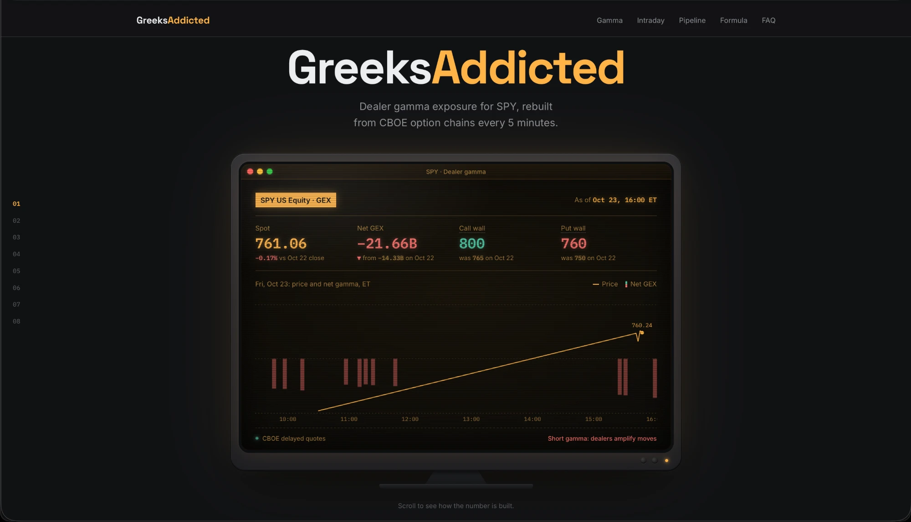
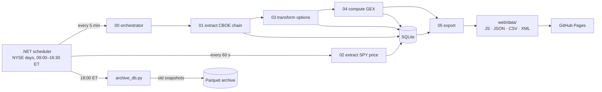

<div align="center">

<a href="https://ipca.pt/"><picture>
  <source media="(prefers-color-scheme: dark)" srcset=".github/readme/upca-dark.svg">
  
</picture></a>
&nbsp;&nbsp;&nbsp;&nbsp;&nbsp;&nbsp;
<a href="https://est.ipca.pt/"><picture>
  <source media="(prefers-color-scheme: dark)" srcset=".github/readme/est-dark.svg">
  
</picture></a>

<sub>Project for the Escola Superior de Tecnologia, Universidade Politécnica do Cávado e do Ave</sub>

# GreeksAddicted · SPY gamma ETL

**Dealer gamma exposure (GEX) for SPY, rebuilt every 5 minutes from the full CBOE option chain.**

[](https://borgebz.github.io/spy-gex-etl/)

[](https://www.knime.com/)
[](scheduler/)
[](scripts/)
[](#data-model)
[](#operations)
[](web/vendor/)
<br>
[](https://github.com/borgebz/spy-gex-etl/actions/workflows/pages.yml)
[](https://github.com/borgebz/spy-gex-etl/commits/main)
[](LICENSE)

[](https://borgebz.github.io/spy-gex-etl/)

[Architecture](#architecture) · [Jobs](#jobs) · [Data model](#data-model) · [Transformations](#transformations) · [Outputs](#outputs) · [Operations](#operations) · [Run it](#run-it)

</div>

## At a glance

|                                |                                                          |
| ------------------------------ | -------------------------------------------------------- |
| :inbox_tray: **Extract**       | ~12,700 SPY contracts from CBOE every 5 min, price every 60 s |
| :gear: **Transform**           | Parse, split OCC symbols, clean, dedupe in KNIME         |
| :abacus: **Compute**           | GEX per contract → strike → snapshot, call and put walls |
| :card_file_box: **Load**       | SQLite (hot), Parquet (archive), static files for the web |
| :calendar: **Schedule**        | .NET 10 worker, NYSE trading days only, 09:00–16:30 ET   |
| :globe_with_meridians: **Serve** | GitHub Pages, no server, no API key in the page        |

What GEX is, the formula, the assumptions and an FAQ are on the [live page](https://borgebz.github.io/spy-gex-etl/).
This README covers how the data is built and run.

<a id="architecture"></a>

## :building_construction: Architecture



| Source                                                                                     | What                                                         | Format                 | Access                |
| ------------------------------------------------------------------------------------------ | ------------------------------------------------------------ | ---------------------- | --------------------- |
| [CBOE delayed quotes](https://cdn-api.cboe.com/api/global/delayed_quotes/options/SPY.json) | Full SPY chain, ~12,700 contracts with gamma, OI, IV, volume | JSON, ~5.7 MB per file | Public, ~15 min delay |
| [Financial Modeling Prep](https://site.financialmodelingprep.com/)                         | SPY last price                                               | JSON (REST)            | API key               |
| `workflow/config.json`                                                                     | URLs, DB path, FMP token                                     | JSON                   | Local, gitignored     |

<a id="jobs"></a>

## :clipboard: Jobs

| Job                     | Runs        | Does                                                                                     | Writes                       |
| ----------------------- | ----------- | ---------------------------------------------------------------------------------------- | ---------------------------- |
| `00-orchestrator`       | Every 5 min | Calls 01 → 03 → 04 → 05                                                                  | –                            |
| `01-extract-cboe-chain` | via 00      | GET the chain; store the body with file time and market time; skip a file already stored | `raw_cboe_options_quotes`    |
| `02-extract-spy-price`  | Every 60 s  | GET the SPY quote; skip repeats                                                          | `price_tick`                 |
| `03-transform-options`  | via 00      | Parse, split the OCC symbol, clean, dedupe                                               | `option_snapshot`            |
| `04-compute-gex`        | via 00      | GEX per contract → strike → snapshot; call and put walls                                 | `gex_strike`, `gex_snapshot` |
| `05-export`             | via 00      | Query the DB; write the page files                                                       | `web/data/*`                 |
| `archive_db.py`         | 18:00 ET    | Retention: raw files and old option snapshots out of SQLite                              | Parquet                      |

<details>
<summary>KNIME workflow diagrams</summary>

**01 · Extract CBOE chain**


**03 · Transform options**


**04 · Compute GEX**


**05 · Export**


</details>

<a id="data-model"></a>

## :card_file_box: Data model

One SQLite file (`workflow/data/spy_gex.db`, WAL mode). Times are ISO 8601 UTC text.

| Table                     | Grain                    | Key                                       | Main columns                                                                          |
| ------------------------- | ------------------------ | ----------------------------------------- | ------------------------------------------------------------------------------------- |
| `raw_cboe_options_quotes` | One CBOE file            | `snapshot_ts_utc` (unique)                | `market_ts_utc`, `source_url`, `status_code`, `body` (raw JSON)                       |
| `option_snapshot`         | One contract in one file | `snapshot_ts_utc` + `option_symbol`       | `expiry`, `type`, `strike`, `spot`, `gamma`, `open_interest`, `iv`, `delta`, `volume` |
| `gex_strike`              | One strike in one file   | `snapshot_ts_utc` + `strike`              | `call_gex`, `put_gex`, `net_gex`                                                      |
| `gex_snapshot`            | One market time          | `snapshot_ts_utc`; unique `market_ts_utc` | `spot`, `call_gex`, `put_gex`, `total_gex`, `call_wall`, `put_wall`                   |
| `price_tick`              | One SPY quote            | `market_ts_utc`                           | `price`, `volume`, `source`                                                           |

Two times on every snapshot:

- `snapshot_ts_utc`: when CBOE built the file.
- `market_ts_utc`: the market time of the data (CBOE `last_trade_time`, New York → UTC). Every
  chart and join uses this one. A file is built about 15 minutes after its market time.

<a id="transformations"></a>

## :arrows_counterclockwise: Transformations

- **Parse:** JSON Path + Ungroup turn one file into one row per contract.
- **Regex:** `SPY(\d{6})([CP])(\d{8})` splits `SPY261023C00765000` into expiry `2026-10-23`,
  type `C` and strike `765.000`.
- **Clean:** keep open interest > 0 and gamma > 0. About a third of the chain drops out.
- **Dedupe:** one row per file and contract. One GEX row per market time: when CBOE rebuilds a file
  for the same market time (the pre-open file brings new open interest), 04 replaces the old row.
- **Compute:** a Rule Engine sets the sign (calls +1, puts −1). A Math Formula computes
  `gamma × OI × 100 × spot² × 0.01 × sign`. Pivot and GroupBy sum per strike, then per snapshot.
- **Join:** two Joiners attach the call wall and the put wall to each snapshot.
- **Empty runs:** an Empty Table Switch ends 04 cleanly when there is no new file.

<a id="outputs"></a>

## :outbox_tray: Outputs

`05-export` writes four files. The page reads the `.js` files, so it also opens from disk with no
server.

| File                                                               | Content                                             | Format     |
| ------------------------------------------------------------------ | --------------------------------------------------- | ---------- |
| [`web/data/data.js`](web/data/data.js)                             | Everything the page needs (`window.GEX_DATA`)       | JavaScript |
| [`web/data/gex_snapshot.json`](web/data/gex_snapshot.json)         | GEX per market time                                 | JSON       |
| [`web/data/gex_strike_latest.csv`](web/data/gex_strike_latest.csv) | GEX per strike, latest snapshot                     | CSV        |
| [`web/data/gex_daily.xml`](web/data/gex_daily.xml)                 | Last snapshot of each trading day                   | XML        |
| [`web/data/history.js`](web/data/history.js)                       | GEX per snapshot and prices of the earlier sessions | JavaScript |

<a id="operations"></a>

## :wrench: Operations

- **Scheduler** (`scheduler/`, .NET 10 worker, macOS LaunchAgent). It runs jobs only on NYSE
  trading days (holiday list in `appsettings.json`), 09:00–16:30 ET. A gate keeps the archive job
  alone on the DB. Each KNIME run gets its own data folder and its own log file (kept 7 days).
  At start it copies the workflows to a run folder, so an open KNIME window does not lock them.
- **Retention** (`scripts/archive_db.py`). Raw CBOE files are deleted after 2 days, once parsed.
  Option snapshots older than 7 days move to Parquet (zstd, one file per day, about 5 MB), checked
  by row count and total OI, then deleted. The last snapshot of each day stays in SQLite.
- **Deploy** (`.github/workflows/pages.yml`). Every push that changes `web/` publishes it to GitHub
  Pages. The public page shows the data of the last push.

<a id="design-decisions"></a>

## :bulb: Design decisions

- **KNIME + NodePit Batch.** Visual workflows document themselves for the course. KNIME's own batch
  executor is no longer free, so headless runs use [NodePit Batch](https://nodepit.com).
- **CBOE public JSON.** Free, no key, the full chain with Greeks. Trade-off: about 15 minutes late.
- **Raw layer in SQLite.** The original JSON is kept, so 03 and 04 can be re-run without fetching.
- **Market time, not file time.** Prices and GEX line up on what the market did, not on when a file
  was built.
- **The DB is output, not source.** It is gitignored. Results ship as small readable files.
- **`data.js` next to the JSON.** Browsers block `fetch` from `file://`. A `<script>` tag works.
- **No API key in the page.** The public page shows stored prices only.

<a id="run-it"></a>

## :rocket: Run it

You need KNIME Analytics Platform 5.12 with the NodePit Batch extension, and an FMP API key.

1. Copy `workflow/config.example.json` to `workflow/config.json`. Set the absolute `SQLITE_PATH`
   and your FMP token.

> [!WARNING]
> Some paths are absolute and point to the author's machine. Change them to your clone's path:
> the **JSON Reader** in workflows 01–05 (it reads `config.json`), the four **Java Snippets** in
> `05-export` (they write `web/data/`), and `scheduler/appsettings.json`. NodePit Batch sets no
> KNIME mountpoint, so relative and `knime://` paths fail in headless runs.

2. Open `workflow/` as the KNIME workspace. Run `00-orchestrator`, and `02-extract-spy-price` for
   prices.
3. Open `web/index.html`.

Headless (close the KNIME window first: open workflows are locked):

```bash
knime -nosplash -consoleLog -application com.nodepit.batch.application.NodePitBatchExecutor \
  --launcher.suppressErrors -r --no-save workflow/00-orchestrator
```

<a id="repository"></a>

## :file_folder: Repository

```
workflow/      KNIME workspace: 00–05, config.example.json
scheduler/     .NET 10 worker: market calendar, price / pipeline / archive jobs
scripts/       archive_db.py: SQLite → Parquet retention
web/           the page: index.html, css/, js/, vendor/ECharts, data/ (written by 05)
.github/       Pages deploy workflow, README image
```

<a id="limits-and-next"></a>

## :compass: Limits and next

- CBOE gives a snapshot only, with no back-fill: history exists only for the days the pipeline ran.
- The scheduler is macOS-only (LaunchAgent, `caffeinate`), and SQLite allows one writer at a time.
- Next: weeks of snapshots, then GEX against next-day absolute return and realized volatility; a
  gamma-flip level; SPX next to SPY; the pipeline in .NET on a server with retries and alerts.

<a id="licence"></a>

## :scroll: Licence

[MIT](LICENSE). Apache ECharts in `web/vendor/` keeps its own Apache-2.0 licence. The UPCA and EST logos
are trademarks of the Universidade Politécnica do Cávado e do Ave. Market data belongs to CBOE and Financial Modeling Prep, under their terms.
